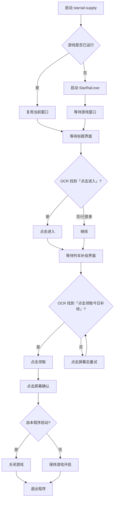

# starrail-supply · 星穹签到助手

> 不开浏览器，直接启动《崩坏：星穹铁道》，识别并领取「列车补给」的 Windows 小工具。
>
> 仓库地址：<https://github.com/xingchen-0220/StarRail-supply>

`starrail-supply` 是一个基于**图像识别 + 模拟鼠标点击**的星铁每日补给领取工具。
它不读取游戏内存、不修改游戏文件、不处理账号密码，只做一件事：

**启动游戏 → 等「点击进入」→ 点击 → 等「点击领取今日补给」→ 点击 → 关闭游戏。**

支持每天定时执行，所有识别与点击都在本机完成。

---

## 这个仓库是什么

- 一个可独立运行的 Windows GUI 程序（Python + tkinter）；
- 一套完整的「截图 → OCR → 文字定位 → 模拟点击」实现；
- 一个开箱可用的每日补给自动领取方案；
- 从 [March7thAssistant](https://github.com/moesnow/March7thAssistant) 的启动与图像识别思路中提取、重新实现的轻量版本。

## 这个仓库不是什么

- **不是米游社/网页签到工具**：不需要 Cookie、不需要账号密码，也不调用任何签到 API；
- **不是内存挂/修改器**：不注入游戏进程、不读写游戏内存；
- **不是通用脚本平台**：只针对「列车补给」这一条固定流程做了优化，目标是稳定、简单。

---

## 功能

| 功能 | 说明 |
| --- | --- |
| 一键领取 | 自动启动游戏，识别并点击「点击进入」和「点击领取今日补给 / 今日奖励」 |
| 步骤浮窗 | 屏幕左下角显示 1/7 ~ 7/7 的实时进度，置顶、鼠标穿透、不抢游戏焦点 |
| 每日定时 | 程序内定时，或创建 Windows 计划任务（无需保持程序运行） |
| 互斥保护 | 已创建计划任务时自动关闭程序内定时，避免重复执行 |
| 路径检测 | 注册表 + 常见安装目录自动检测 `StarRail.exe`，也支持手动选择 |
| 日志与截图 | 实时日志、失败截图、当前画面 OCR 文字，方便定位问题 |
| 现代界面 | 左侧导航：首页 / 定时签到 / 运行日志 / 设置 / 关于 |
| 管理员支持 | 程序以管理员权限运行，解决游戏启动与模拟点击的权限问题 |

---

## 界面

首页：


关于 / 支持作者：


运行时的左下角步骤浮窗：


---

## 工作流程



固定的 7 个浮窗步骤：

1. 启动游戏
2. 等待游戏加载
3. 正在进入游戏
4. 等待领取入口
5. 正在领取
6. 确认领取
7. 关闭游戏 / 签到完成

---

## 技术栈

| 模块 | 技术 |
| --- | --- |
| 界面 | Python 3.12 + tkinter（无重型 GUI 框架） |
| 截图 | mss 抓取游戏客户区，PrintWindow 兜底 |
| OCR | RapidOCR（PP-OCRv4 ONNX 模型，本地离线） |
| 图像处理 | OpenCV + NumPy + Pillow |
| 键鼠模拟 | Windows SendInput（ctypes / pywin32） |
| 窗口控制 | Win32 API（EnumWindows、ClientToScreen、SetForegroundWindow） |
| 打包 | PyInstaller onefile，内置 OCR 模型与管理员清单 |

不需要联网，OCR 模型随 EXE 一起打包。

---

## 目录结构

```text
starrail-supply/
├─ main.py                  入口：GUI / --auto 计划任务模式
├─ app/
│  ├─ gui.py                左侧导航界面、定时与日志
│  ├─ signin.py             固定签到流程（7 步状态机）
│  ├─ vision.py             截图、OCR、模板/文字匹配、点击
│  ├─ ocr_engine.py         RapidOCR 封装
│  ├─ winapi.py             Windows 窗口与键鼠注入
│  ├─ launcher.py           游戏路径检测与启动
│  ├─ overlay.py            左下角步骤浮窗
│  ├─ config.py             JSON 配置
│  ├─ geom.py               归一化坐标/区域解析
│  └─ logger.py             文件 + 界面日志
├─ assets/                  程序图标、赞赏码
├─ docs/                    截图
├─ tools/selftest_flow.py   假窗口端到端自测
├─ build.spec / build.ps1   PyInstaller 打包
├─ requirements.txt
├─ README.md
├─ REPO_INTRO.md            本文件
└─ LICENSE                  GPL-3.0
```

---

## 运行与打包

环境：Windows 10/11、Python 3.12。

```bat
git clone https://github.com/xingchen-0220/StarRail-supply.git
cd starrail-supply
python -m pip install -r requirements.txt
python main.py
```

打包 EXE：

```bat
.\build.ps1
```

输出 `dist\星穹签到助手.exe`，约 100 MB，已内置 OCR 模型，并带 `requireAdministrator` 清单。

自测（不需要真实游戏，使用假窗口验证完整点击链路）：

```bat
python tools\selftest_flow.py
```

---

## 使用要求

- Windows 10/11；
- 游戏窗口比例 **16:9**，推荐 **1920×1080**；
- 以**管理员身份**运行（`StarRail.exe` 本身要求管理员，普通权限无法启动，模拟点击也会被 UIPI 拦截）；
- 游戏账号已登录（启动器记住账号）；
- 游戏建议使用「窗口化 / 无边框窗口」，独占全屏可能导致截图失败。

---

## 已知限制

- 只覆盖「点击进入 → 列车补给」这一条流程；登录界面、公告弹窗、版本更新等需要人工处理。
- 游戏更新后如果界面文字或位置变化，可能需要调整识别文字或等待时间。
- 识别基于截图，游戏被其他窗口遮挡时可能识别不到。
- 不处理账号密码，不绕过任何登录/安全验证。

---

## 常见问题

**启动游戏报 `WinError 740`？**
程序没有以管理员运行。右键 → 以管理员身份运行。

**一直等「点击进入」？**
游戏还在加载/更新，或账号未登录；查看 `data\logs` 与 `data\screenshots`。

**点击没反应 / 截图是黑的？**
游戏是独占全屏，或程序与游戏权限不一致。改成无边框窗口，并确认程序以管理员运行。

**计划任务没有执行？**
在任务计划程序查看 `星穹签到助手-每日签到` 的「上次运行结果」。修改时间要先删除任务再创建。

**会封号吗？**
本工具只发送普通鼠标点击，不注入进程、不修改内存。但任何自动化都可能违反游戏用户协议，请自行评估风险。

---

## 支持作者

**觉得好用就支持一下呗！**

- 作者：梦和星辰
- B站UID：1321645331
- B站主页：<https://space.bilibili.com/1321645331>


---

## 开源协议与致谢

本项目参考了 [moesnow/March7thAssistant](https://github.com/moesnow/March7thAssistant) 的游戏启动与图像识别思路，
以 **GPL-3.0** 协议开源，完整协议见 [LICENSE](LICENSE)。

- 原项目：<https://github.com/moesnow/March7thAssistant>
- OCR：RapidOCR（PaddleOCR 模型的 ONNX 实现）
- 界面：Python tkinter

请遵守游戏用户协议，使用脚本的风险由使用者自行承担。


